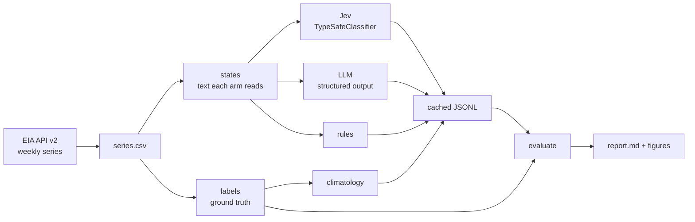

# jev-calibration-audit

**An independent test of whether TypeSafe AI's Jev returns probabilities you can trust.** Jev answers
typed questions with calibrated probabilities instead of text. This repo checks that claim on U.S.
petroleum inventory reports, where the right answer can be computed exactly from EIA data. It compares
Jev with an LLM-as-classifier asked the same questions, word for word, through LangChain.

[](https://github.com/n9omi/jev-calibration-audit/actions/workflows/ci.yml)

## Why this exists

Jev is a *System One* model: you send a state and typed questions (Noul = yes/no, Choice = pick one,
Score = ordered levels) and get back probabilities. TypeSafe trains it for calibrated decisions, and
the speed and cost advantages it reports over LLMs come from its own evaluations. If the probabilities
are calibrated, they are more than labels: you can threshold them, aggregate them into indices, and
use them as features. If they are not, every downstream use inherits the error.

So the questions this audit answers are:

1. **Calibration.** When Jev says 0.8, is it right about 80% of the time?
   (reliability diagrams, ECE, Murphy decomposition, Spiegelhalter test)
2. **Against the alternative.** Does it beat an LLM-as-classifier on proper scoring rules, and
   at what cost and latency? (paired Brier/RPS differences, Diebold–Mariano tests)
3. **Under difficulty.** Does calibration hold when the answer needs arithmetic, and when the
   answer is genuinely uncertain because it is about next week?
4. **Confidence.** Is Jev's `confidence` field a useful signal for when to abstain?
5. **Repairability.** Is any miscalibration fixable with an out-of-time recalibration layer?

## Design



### Ground truth

Labels come from EIA weekly series, never from a model: commercial crude ex-SPR (`WCESTUS1`),
gasoline (`WGTSTUS1`), distillate (`WDISTUS1`), Cushing (`W_EPC0_SAX_YCUOK_MBBL`) and refinery
utilization (`WPULEUS3`). A missing week breaks the week-over-week diff instead of silently
spanning two weeks.

### Question bank ([`configs/questions.yaml`](configs/questions.yaml))

| question | type | horizon | what it tests |
|---|---|---|---|
| `crude_draw`, `gasoline_draw`, `distillate_draw`, `cushing_draw` | Noul | 0 | did stocks fall this week |
| `crude_change_bucket` | Score (5 levels) | 0 | size of this week's crude change |
| `refinery_util_bucket` | Score (4 levels) | 0 | utilization band |
| `largest_pct_mover` | Choice (3) | 0 | which product moved most in % terms (arithmetic) |
| `next_crude_draw`, `next_gasoline_draw` | Noul | 1 | will next week's report show a draw (forecast) |
| `next_crude_bucket` | Score (5 levels) | 1 | size of next week's crude change (forecast) |

Every arm receives identical instructions and criteria. Editing the wording changes a fingerprint
that invalidates cached predictions, so two wordings are never scored together.

### State views

| view | what the arm reads | why |
|---|---|---|
| `with_changes` | changes and new levels, stated | horizon 0 is mostly extraction |
| `levels_only` | this week's and last week's levels, no changes | horizon 0 needs subtraction / % math |
| `wpsr_text` | real EIA Weekly Petroleum Status Report highlights you supply | external validity |

Templated text is phrased several ways, in million or thousand barrels, with exact numbers, so every
horizon-0 label is fully determined by the text. Dates are stripped by default. For `wpsr_text`, save
the highlights as `data/raw/wpsr_text/YYYY-MM-DD.txt`, named by week-ending date, and add the view
in the config.

### Arms

| arm | role |
|---|---|
| `jev` | `langchain_typesafe.TypeSafeClassifier`; all questions in one request |
| `llm_*` | any `init_chat_model` string with structured output; verbalized probabilities; one call per state |
| `rules` | regex parser, deterministic answers; shows which questions are pure extraction |
| `climatology` | historical base rate using only earlier weeks; the bar for forecast skill |
| `mock_*` | demo only: simulated calibrated / overconfident forecasters that read the labels |

### Metrics

Noul: Brier, Brier skill vs climatology, log loss, ECE (uniform and equal-mass bins), Murphy
decomposition, Spiegelhalter Z, AUROC. Choice: multiclass Brier, NLL, top-label and classwise
ECE. Score: ranked probability score (the proper score for ordered levels). Comparisons use
the paired loss difference on identical items, a circular block-bootstrap CI and a
Diebold–Mariano test with Newey–West variance, because weekly losses are autocorrelated.
Recalibration fits Platt and isotonic maps on earlier weeks only. All metric tables use the
common sample of items every arm answered, and coverage is reported separately.

## Quickstart

```bash
git clone https://github.com/n9omi/jev-calibration-audit && cd jev-calibration-audit
python -m venv .venv && source .venv/bin/activate
pip install -e ".[jev,llm,dev]"

# 1. Offline demo: synthetic data, no keys, about 10 seconds
jev-audit demo                          # -> reports/demo/report.md

# 2. Real run
cp .env.example .env                    # add EIA, TypeSafe and LLM provider keys
jev-audit fetch                         # EIA series -> data/raw/series.csv
jev-audit build                         # states + labels
jev-audit run --arm jev --limit 20      # smoke test a few calls first
jev-audit run --arm jev
jev-audit run --arm llm_sonnet
jev-audit run --arm rules && jev-audit run --arm climatology
jev-audit evaluate                      # -> results/wpsr-v1/*.csv, reports/wpsr-v1/report.md
```

Runs are cached in `results/<run>/raw/<arm>.jsonl` and resume where they stopped; failed calls are
retried on the next run. Set `LANGSMITH_TRACING=true` to trace every classification in LangSmith.

## Prospective track

Historical EIA reports are public and may be in any model's training data, and stripping dates
only partly mitigates that. The strongest evidence comes from weeks published **after** the model
you test was released (Jev launched 15 September 2026). Each Wednesday after the EIA release, run
`jev-audit all` with `eval_start` set to the release date and a pinned model id. The sample grows
weekly and none of it can be memorized.

## Repository layout

```
configs/      experiment.yaml (real run), demo.yaml (offline), questions.yaml
src/jev_audit/
  data/       eia.py, synthetic.py, states.py (rendering), parse.py, labels.py
  arms/       jev.py, llm.py, rules.py, climatology.py, mock.py
  metrics/    binary.py, multiclass.py, compare.py, recalibrate.py
  evaluate.py, report.py, plots.py, pipeline.py, runner.py, cli.py
tests/        metrics, labels, render/parse round-trip, Jev arm on a mocked HTTP transport, end to end
```

## Caveats

- The `with_changes` and `levels_only` views are templated, which makes labels exact but the prose
  artificial. `wpsr_text` is the check on real report language.
- The LLM arm uses verbalized probabilities. Token log-probabilities are a separate experiment.
- Jev's `confidence` is a concentration measure, not the chosen label's probability, so it is only
  evaluated as an abstention signal.
- `jev-latest` and provider aliases can change. Pin model ids and record run dates for anything you
  publish.
- Cost figures use the prices in the config. Jev was listed at launch at $0.04 per 1M input tokens with
  free output; verify current pricing before quoting it.

## References

- LangChain, [Building a Harness with Jev](https://www.langchain.com/blog/building-a-harness-with-jev)
- [`langchain-typesafe`](https://docs.langchain.com/oss/python/integrations/providers/typesafe) integration docs
- EIA [Open Data API v2 documentation](https://www.eia.gov/opendata/documentation.php)
- Murphy (1973), *A new vector partition of the probability score*; Spiegelhalter (1986),
  *Probabilistic prediction in patient management and clinical trials*; Diebold & Mariano (1995),
  *Comparing predictive accuracy*; Harvey, Leybourne & Newbold (1997)

## License

MIT. Not affiliated with TypeSafe AI, LangChain or the EIA.
